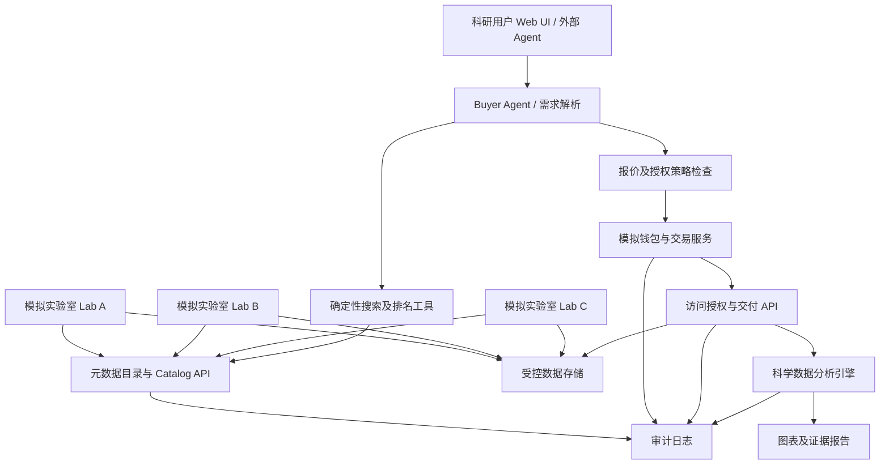

# SciExchange — 项目交接文档（Handover Note）

**项目暂定名称：** SciExchange  
**一句话定位：** *面向 AI Agent 的可信科学实验数据交易与共享平台。*  
**文档版本：** v1.0（中文版）— 2026 年 10 月 21 日，新加坡时间  
**项目状态：** **设计提案 / Hackathon 实施计划。** 除非通过实际仓库核实，否则本文所描述的组件均不能视为已经开发完成或通过测试。  
**目标读者：** 团队成员、技术负责人、产品与界面设计者、评审人员，以及 AI Coding Agent。  
**MVP 科学领域：** 电池老化实验（Battery Aging），采用**合成实验数据与模拟云实验室**。  
**交付目标：** 完成一套可演示的端到端 Hackathon 原型，而非生产级数据交易基础设施。

---

## 0. 请先阅读本节（面向人类与 AI Agent）

### 0.1 一句话说明项目使命

打造一个原型平台：科研人员或其他 AI Agent 可以通过自然语言描述所需的科学实验数据；系统能够从多个模拟云实验室发现相关数据集，验证使用权限及数据来源，在预算范围内完成**模拟购买**，最后返回可访问的数据和具有科学意义的分析结果。

### 0.2 已经在概念层面达成一致的方向

- 项目的长期背景是：未来可能出现更多可通过网络远程控制、自动执行实验的云实验室（Cloud Lab）。
- 实验不仅会产生成功结果，也会产生失败结果。这些具有适当授权的实验记录，可能在原实验之外仍具有研究价值。
- 科学数据交易平台有机会帮助研究人员和 Agent 发现、获得与复用这些数据。
- 必须重视隐私、知识产权、可追溯性、访问权限以及可审计性。
- 当前目标是**能够现场运行的 Hackathon MVP**，而不是一次完成真实商业基础设施。

### 0.3 推荐的技术决策（尚未由团队最终确认）

1. 使用 **3 个模拟实验室节点**，搭建一个中心化元数据目录、受控数据存储、一个 Buyer Agent，以及一个模拟支付服务。
2. 将演示范围限定在**电池循环老化实验**，不同时支持化学、物理、生物等多个复杂领域。
3. 数据以**合成数据（Synthetic Data）**为主，使用虚拟积分（Demo Credits）或注明为模拟的美元等价价格；所有交易必须标记为模拟。
4. 由后端确定性程序执行搜索、授权、预算检查、支付记账、哈希验证和科学计算；LLM 主要负责解释自然语言需求、制订搜索/采购计划、说明匹配理由和总结结果。
5. 使用 SHA-256、来源元数据及审计日志提供基本的完整性验证与可追溯性；**不强制引入区块链或真实加密货币**。
6. 为将来的 x402 或 Agent Wallet 集成预留接口，但不将其作为 Demo 必需依赖。

### 0.4 术语澄清

本项目的 MVP 本质上是一个**由 AI Agent 辅助检索与采购的中心化科学数据交易平台**，**不是联邦学习（Federated Learning）**。未来可以增加联邦目录查询、数据不出域计算或隐私保护分析，但这不属于本次 MVP 的范围。

---

## 1. 项目背景与问题定义

### 1.1 灵感来源

Emerald Cloud Lab 是远程自动化实验室的代表性案例之一。科研人员通过软件设计、运行、管理与分析实验，而不必亲自在实验设备旁操作。随着云实验室、自动化仪器和科学 AI Agent 的发展，分布在不同地点的实验设施可能产生大量实验数据。

目前，这些数据可能由于机构边界、保密协议、格式不统一、商业敏感性、元数据不完整，以及缺乏分享激励而被隔离。即使是**失败实验**，只要清楚记录条件、测量结果与来源，也可能帮助其他研究者避免重复尝试或排除无效假设。

### 1.2 核心问题（Problem Statement）

> 如何让科研人员及自主科学 Agent 安全地发现、取得授权、付费购买并复用不同实验室产生的数据，同时确保数据不能被当作来源不明、未经验证的普通商品？

### 1.3 核心假设（Core Hypothesis）

一个提供**标准化科学元数据、受控访问、自动化采购以及以证据为导向的分析**的平台，可以提高分散实验数据的可发现性和复用价值。

### 1.4 价值主张（Value Proposition）

- **对数据购买方：** 根据科学问题查找数据、理解为什么匹配、比较实验条件、控制预算，并核实数据来源。
- **对实验室提供方：** 自主选择公布哪些数据、设置许可证和访问限制、制定价格，并审查交易记录。
- **对 AI Agent：** 通过结构化 API / Tool 调用，而不是手动浏览网页来完成数据采购；所有操作均受明确的授权和支出上限约束。

### 1.5 基本假设与限制

- MVP **不连接任何真实云实验室**。
- 模拟 Lab A/B/C 是虚构节点，不得暗示与真实机构存在合作。
- **公开可访问不等于拥有转售许可。** 演示购买仅代表虚构数据授权；如使用现实公开数据，必须遵守来源的实际许可证和署名要求。
- SHA-256 哈希只能够帮助确认文件字节是否与登记版本一致，**不能证明实验确实发生或数据在科学上正确**。
- 本平台目前**不是**实验室安全控制系统、真实金融服务、自动化法律授权系统或生产级隐私保护平台。

---

## 2. 项目目标与成功标准

### P0 — 演示必须能够完成

1. 初始化 **3 个模拟 Lab** 与**至少 6 个不同实验条件的数据集**。
2. 允许在未购买的情况下搜索元数据，但不能读取受保护的原始数据。
3. 接收自然语言研究需求以及严格的最高预算。
4. 生成结构化的候选数据集排名，并显示科学匹配原因、价格及限制。
5. 对无权限、禁止出售或超出预算的购买请求直接拒绝。
6. 完成一次具有幂等性（Idempotency）的模拟购买，生成数据访问许可（Access Grant）、收据以及审计事件。
7. 下载数据前验证所存储文件的 SHA-256。
8. 向已授权买家提供 CSV/JSON 数据，并执行简单、可复现的科学分析，例如比较不同温度下的容量随循环次数变化。
9. 展示简单直观的结果页面：已选择的数据集、总花费、数据来源、单位/条件、趋势及不确定性或限制。
10. 实现一条可以重复运行的完整流程，并提供脚本或按钮重置 Demo 状态。

### P1 — 时间允许时追加

- 实验室提供方上传界面及 Schema 验证。
- 面向其他 Agent 的 HTTP Tool 规范或 MCP Adapter。
- 对成功与失败实验进行对比，增加失败标签。
- Human-in-the-loop 购买审批。
- 哈希链审计日志及签名收据。
- Telegram Bot 或只读通知接入。

### P2 — Hackathon 后再考虑

真实支付结算、链上智能合约、去中心化存储、联邦学习、真实实验室对接、自动下单执行实验、真实平台分润、自动化法律授权检查、完整的隐私计算及生产级多租户系统。

### 明确不做（Non-goals）

- 不训练新的基础模型。
- 不构建真正的湿实验室（Wet Lab）设备控制系统。
- 不在未经授权的情况下出售其他人的真实科研数据。
- 不因系统采用 SHA-256 或数据库日志就声称数据具有密码学意义上的不可篡改性。

---

## 3. 目标用户与演示场景

### 3.1 参与者（Actors）

| 角色 | 职责 | MVP 中的实现 |
|---|---|---|
| Lab Provider（实验室提供方） | 登记实验元数据、价格、使用授权及数据文件 | 模拟 Lab A/B/C 与 Seed 脚本 |
| Human Researcher（科研用户） | 提出科学问题与预算上限 | Web UI |
| Buyer Agent（采购 Agent） | 理解需求、筛选数据集、调用受控工具 | 一条 LLM 辅助工作流 |
| Marketplace Backend（交易平台后端） | 搜索、权限验证、交易、交付 | FastAPI 服务 |
| Auditor/Admin（审计员/管理员） | 检查来源、交易、数据版本与完整性事件 | Audit Dashboard / 日志 |

### 3.2 核心演示问题

> “请寻找能够比较约 25°C 和 40°C 条件下电池容量衰减的实验数据。我的预算为 10 个 Demo Credits。购买能够进行合理比较的数据集，并展示容量随充放电循环次数变化的趋势。”

### 3.3 预期结果

Agent 从不同模拟实验室找到数据，按照温度、测量字段与许可证筛选；解释实验条件存在的差异；选择在 10 Credits 内的组合；请求模拟购买；获得访问权限；验证文件哈希；绘制容量保持率与循环次数曲线；并对每条曲线注明数据来源和实验条件。

### 3.4 必须呈现的科学限制

不同电芯的材料体系、充放电电流、放电深度、样本使用历史、仪器及测量流程，都可能影响容量衰减。MVP 可以并排展示数据，但在实验条件没有被充分控制时，**不得宣称观察到的差异一定由温度造成**。

---

## 4. 系统架构（System Architecture）



### 4.1 组件及职责

**A. Provider Ingestion & Catalog（数据接入与目录）**

- 登记实验室与数据集元数据。
- 验证 Schema、测量单位、必填实验参数、原始文件格式及访问策略。
- 数据接入时计算校验哈希，保存有版本号的元数据。
- 公开可搜索的元数据；未经授权不能读取受控原始数据。

**B. Scientific Search & Matching（科学数据搜索及匹配）**

- 将自然语言需求转换为类型化筛选条件（例如 `domain=battery`、温度范围、测量指标、实验类型）。
- 默认只检索**元数据**。
- 根据科学匹配度、数据质量、可比性、价格及授权资格排序。
- 解释数据是否具有实际可比性，并提示缺失的实验元数据。

**C. Buyer Agent（LLM 编排层）**

- 理解自然语言、调用预定义 Tool、总结证据，并在必要时请求购买确认。
- 不允许直接执行任意 SQL、绕过授权判断、私自创建访问凭证或直接扣款。
- 返回结构化 JSON，明确展示约束与选中的 Dataset ID。

**D. Licensing & Access Control（许可及访问控制）**

- 每个数据集包含明确的可见性、许可证与用途限制。
- 在交付前检查买家身份、允许用途，以及系统实际实现的地域或其他限制。
- 根据提供方可见性策略，`private` 数据集即使出现在内部检索中，也不能被无权限用户购买。

**E. Mock Payment & Access Grant（模拟支付与访问授权）**

- 使用整数 Credits 或最小货币单位进行报价。
- 原子化检查余额、支出上限；利用 Idempotency Key 防止重复扣款。
- 成功后生成收据，以及绑定买家、数据集 ID 与数据版本的访问授权。
- 每笔交易显著注明 `SIMULATED`。

**F. Validation, Analysis & Reporting（数据验证、分析及报告）**

- 下载时重新计算哈希，并与登记值比对。
- 正确解析数值列、单位，只进行有记录的确定性转换。
- 生成轴标签完整、来源可追溯的分析图表。
- 清楚区分实测数据、合成/模拟数据与 AI 推断总结。

**G. Audit & Observability（审计与可观测性）**

- 记录注册、搜索（避免敏感查询泄露）、权限判断、报价、购买、授权、下载、完整性检查和分析等事件。
- 审计字段包括 Actor ID、时间戳、对象 ID、动作、结果和 Correlation ID；不存储密钥或不必要的原始敏感内容。

---

## 5. 三条端到端 User Stories

### Story A — 实验室发布数据集

1. Provider 完成身份验证（演示也可由 Seed 脚本代表模拟实验室执行）。
2. 上传数据集元数据和 CSV 文件。
3. 平台验证列名、单位、缺失值、数据范围及使用政策。
4. 平台计算 SHA-256，并将文件保存至内部受控位置。
5. Provider 设置元数据可见性与许可证；MVP 只允许购买 `DEMO_SHAREABLE` 数据。
6. 平台发布目录条目，并记录数据注册事件。

### Story B — Buyer Agent 采购数据

1. Buyer 提交科学问题、使用目的和最高预算。
2. Agent 生成经 Schema 验证的 `SearchIntent` 对象。
3. 后端返回匹配数据集及其元数据、价格、许可证、匹配特征。
4. Agent 对候选进行排序；**后端必须独立重新执行所有硬性约束检查**。
5. Agent 展示采购计划，并在要求时取得人工确认。
6. 后端根据权威报价验证权限、扣除虚拟积分、颁发访问授权。
7. Buyer 读取获授权数据、验证哈希，并运行科学分析。
8. 前端显示曲线、科学限制、来源信息、积分余额和交易收据。

### Story C — 数据被篡改或访问受到限制

- 如果 CSV 在登记哈希后被修改，系统返回 `INTEGRITY_CHECK_FAILED`，阻止数据交付并记录审计事件。
- 如果买家试图购买私有或未获授权的数据，后端返回 `403 FORBIDDEN` 或 `409 POLICY_CONFLICT`，同时避免泄露受保护内容。
- 如果购物组合超过用户预算或余额，交易必须整体失败，且**不能产生部分扣款**。

---

## 6. 数据模型与科学元数据

### 6.1 最小数据集元数据契约

以下 JSON 使用**虚构示例值**，并非真实研究测量结果。为保持代码接口一致，机器读取的字段名、枚举与 ID 保留英文；描述性文本使用中文。

```json
{
  "dataset_id": "ds_lab_a_25c_001",
  "version": 1,
  "lab_id": "lab_a",
  "title": "25°C 锂离子电池循环老化合成数据",
  "description": "仅用于演示的电池容量-循环次数合成测量数据",
  "domain": "battery",
  "experiment_type": "cycling_aging",
  "sample": {
    "chemistry": "Li-ion",
    "cell_format": "18650",
    "sample_count": 3
  },
  "conditions": {
    "temperature_c": 25.0,
    "charge_rate_c": 0.5,
    "discharge_rate_c": 1.0,
    "voltage_cutoff_v": 2.7
  },
  "measurements": [
    { "field": "cycle_index", "unit": "count" },
    { "field": "capacity_ah", "unit": "Ah" }
  ],
  "quality": {
    "origin": "synthetic",
    "status": "demo_validated",
    "missing_values_pct": 0.0
  },
  "access": {
    "visibility": "public_metadata",
    "policy": "DEMO_SHAREABLE",
    "allowed_uses": ["demo_research", "demo_analysis"]
  },
  "price_credits": 3,
  "raw_sha256": "<实际计算得到的64位十六进制SHA-256摘要>",
  "source_attribution": "虚构的 Mock Lab A / 自动生成的演示数据集",
  "created_at": "<ISO-8601时间戳>"
}
```

### 6.2 建议的关系型数据库表

| 表名 | 推荐主要字段 | 备注 |
|---|---|---|
| `labs` | `id`, `display_name`, `is_simulated`, `created_at` | MVP 中的模拟数据提供方 |
| `datasets` | `id`, `lab_id`, `version`, `title`, `domain`, `experiment_type`, `metadata_json`, `sha256`, `storage_key`, `visibility`, `policy`, `price_credits`, `status` | 保存元数据；推荐版本不可变 |
| `wallets` | `owner_id`, `balance_credits`, `currency_type` | 仅允许 `currency_type=DEMO_CREDIT` |
| `purchase_orders` | `id`, `buyer_id`, `idempotency_key`, `total_credits`, `status`, `created_at` | `(buyer_id, idempotency_key)` 唯一 |
| `order_items` | `order_id`, `dataset_id`, `dataset_version`, `price_credits` | 保存成交时的价格快照 |
| `access_grants` | `id`, `buyer_id`, `dataset_id`, `version`, `status`, `expires_at` | 下载前检查授权 |
| `audit_events` | `id`, `event_time`, `actor_id`, `action`, `subject_id`, `result`, `correlation_id`, `event_hash`, `prev_hash` | Hash Chaining 可选 |

用户可控制或持有的访问 Token 应使用 UUID 或同等难以猜测的标识。不得向无权限客户端暴露真实文件路径或 Storage Key。价格使用**整数**保存，避免浮点计算误差。

### 6.3 合成 CSV 格式（v1）

```csv
experiment_id,cell_id,temperature_c,cycle_index,capacity_ah
exp_a25,cell_01,25,1,2.00
exp_a25,cell_01,25,2,1.99
exp_a25,cell_01,25,3,1.98
```

每张分析图都必须标出单位。如果不同实验无法直接比较，应分组显示并提示限制，不应盲目将不同条件的数据合并计算平均值。

### 6.4 数据质量检查清单

- 必填字段存在、UTF-8 CSV 能被解析、数值字段单位有定义。
- `cycle_index >= 0`，电池容量为有限且非负数，温度处于合理的已定义范围。
- 适当情况下，`(experiment_id, cell_id, cycle_index)` 组合不能重复。
- 缺失比例与样本数必须如实记录。
- CSV 实际字段与元数据描述一致。
- 科学可比性检查需要考虑：电池化学体系、实验类型、温度、充放电倍率（C-rate）、截止电压，以及测量指标定义。

---

## 7. API 规格（建议 v1）

以下均是**拟定的接口契约**，并非已经实现的 Endpoint。统一前缀为 `/api/v1`。建议使用 FastAPI 自动生成 OpenAPI / Swagger 文档。除文件上传与下载外，优先使用 JSON。

| HTTP 方法与 Endpoint | 调用角色 | 功能 |
|---|---|---|
| `GET /health` | Public | 服务健康检查 |
| `GET /labs` | Buyer | 获取模拟实验室列表 |
| `POST /labs` | Provider/Admin | 注册数据提供方 |
| `POST /datasets` | Provider | 注册元数据及受控上传文件（Multipart 或两阶段上传） |
| `GET /datasets` | Buyer/Agent | 按筛选条件检索目录元数据 |
| `GET /datasets/{id}` | Buyer/Agent | 获取数据集元数据（含可见性及价格） |
| `POST /agent/plan` | Buyer | 自然语言 → 结构化搜索/采购计划；**不扣款** |
| `POST /quotes` | Buyer/Agent | 计算权威价格及购买资格 |
| `POST /purchases` | Buyer/Agent | 原子化扣除虚拟积分、创建收据与授权 |
| `GET /purchases/{id}` | Buyer | 查询收据及交易状态 |
| `GET /datasets/{id}/download` | 已获授权 Buyer | 检查访问许可、验证校验和、返回受控文件 |
| `POST /analysis/battery-aging` | 已获授权 Buyer | 分析指定的已购数据集并返回图表数据 |
| `GET /wallet` | Buyer | 查询演示钱包余额 |
| `GET /audit-events` | Admin/授权 Auditor | 查看审计事件 |
| `POST /demo/reset` | 仅本地 Demo Admin | 重置可复现的演示数据 |

### 7.1 Agent Planning 请求示例

```json
{
  "query": "Compare battery capacity degradation near 25 C and 40 C",
  "max_budget_credits": 10,
  "allowed_uses": ["demo_research"],
  "purchase_mode": "requires_confirmation"
}
```

### 7.2 推荐的 Planning Response

```json
{
  "intent": {
    "domain": "battery",
    "experiment_type": "cycling_aging",
    "requested_temperatures_c": [25, 40],
    "required_measurements": ["cycle_index", "capacity_ah"]
  },
  "candidate_dataset_ids": ["ds_lab_a_25c_001", "ds_lab_b_40c_001"],
  "proposed_dataset_ids": ["ds_lab_a_25c_001", "ds_lab_b_40c_001"],
  "estimated_total_credits": 7,
  "comparability_warnings": ["在得出结论前，请检查 C-rate 和电芯化学体系是否一致。"],
  "requires_confirmation": true
}
```

后端必须重新确认 Dataset ID 是否存在、报价是否仍然有效，以及 Buyer 是否有权购买。**不得把 Agent 返回的 `estimated_total_credits` 直接当作实际扣款金额。**

### 7.3 后端权威报价（Quote）响应

```json
{
  "quote_id": "quote_123",
  "eligible_items": [
    { "dataset_id": "ds_lab_a_25c_001", "version": 1, "price_credits": 3 },
    { "dataset_id": "ds_lab_b_40c_001", "version": 1, "price_credits": 4 }
  ],
  "ineligible_items": [],
  "total_credits": 7,
  "max_budget_credits": 10,
  "status": "READY_FOR_CONFIRMATION"
}
```

### 7.4 Purchase 请求

```http
POST /api/v1/purchases
Authorization: Bearer <session-token>
Idempotency-Key: demo-order-001
Content-Type: application/json
```

```json
{
  "quote_id": "quote_123",
  "max_budget_credits": 10,
  "confirm": true
}
```

错误响应应使用机器可读 Error Code，例如 `UNAUTHORIZED`、`POLICY_DENIED`、`BUDGET_EXCEEDED`、`INSUFFICIENT_FUNDS`、`QUOTE_EXPIRED`、`INTEGRITY_CHECK_FAILED`、`VALIDATION_ERROR`。

---

## 8. Buyer Agent：明确边界及工具设计

### 8.1 Agent 执行工作流

1. **Interpret（理解）：** 将研究问题解析为 `SearchIntent`。若意图有歧义，使用保守假设并予以说明。
2. **Discover（发现）：** 用验证过的筛选条件调用 `search_datasets`。
3. **Evaluate（评估）：** 使用可解释的排名方法，并报告实验数据可比性风险。
4. **Plan（规划）：** 提出尽可能精简、符合预算的候选组合。
5. **Authorize（授权）：** 调用 `get_quote`，执行购买策略，并在需要时取得审批。
6. **Purchase（购买）：** 仅在审批状态或自动购买限额允许时调用 `purchase_quote`。
7. **Verify & Consume（验证与获取）：** 调用 `get_purchased_dataset` 并验证完整性。
8. **Analyze（分析）：** 调用确定性科学分析函数，不得捏造实验测量值。
9. **Explain（解释）：** 引用 Dataset ID 和 Lab 来源；区分合成数据、真实观察证据及模型推断。

### 8.2 LLM 允许调用的工具

```text
search_datasets(filters: SearchIntent) -> DatasetSummary[]
get_dataset_metadata(dataset_id: str) -> DatasetMetadata
get_quote(dataset_ids: str[], budget_credits: int) -> Quote
purchase_quote(quote_id: str, confirmation_token?: str, idempotency_key: str) -> Receipt
get_purchased_dataset(dataset_id: str) -> VerifiedDataset
analyze_battery_aging(dataset_ids: str[]) -> AnalysisResult
get_wallet_balance() -> WalletSummary
```

### 8.3 Agent 运行安全策略（AI 开发者必须遵守）

- 数据集描述、实验室名称、CSV 内容、外部文档都必须被视为**不可信输入**，防范 Prompt Injection。
- 所有权限检查必须在后端 Tool 执行，不能相信 LLM 自称获得授权。
- 不允许任意执行数据文件或 LLM 生成的代码。
- 不得泄露 API 密钥、私有数据、钱包密钥、内部存储路径或服务凭证。
- 无论用户 Prompt 怎样要求，实际扣费均受后端单笔预算与余额限制。
- MVP 默认对付费动作要求人工确认；若增加 `auto_purchase_max_credits`，仅在隔离的 Sandbox 中开启。
- Agent 回答必须引用真实 Dataset ID、测量字段，以及必要的科学限制与不确定性。
- 若 LLM API 失败，允许使用简单规则解析器作为 Demo 降级方案，但应明确标记，不能冒充复杂 AI 推理。

### 8.4 推荐的数据匹配评分方法

先采用透明的加权评分 Baseline，而不是完全依赖未经验证的 LLM 判断：

| 评分维度 | 初始权重 |
|---|---:|
| 必需测量字段匹配 | 35% |
| 实验条件匹配 | 25% |
| 可比性与质量元数据完整度 | 20% |
| 价格效率 | 10% |
| 数据提供方来源信息完整度 | 10% |

这些权重只是**初始启发式参数，不是经过科学验证的标准**。系统应解释得分依据，并对缺失或未知的关键条件施加惩罚。**硬性条件筛选和授权检查必须先于排序执行。**

---

## 9. 隐私、知识产权、安全与可信性

### 9.1 数据权利与同意

数据出售方必须有权分享或授权数据。即使数据没有人名，也可能包含敏感的商业技术细节。MVP 默认只使用合成数据，不假定任何真实实验室同意提供数据。

建议的访问策略字段：

```text
visibility: public_metadata | private
sharing_policy: DEMO_SHAREABLE | RESTRICTED | NOT_FOR_SALE
allowed_uses: demo_research | demo_analysis
owner_reference: ...
source_attribution: ...
license_text_or_url: ...
```

### 9.2 最低限度安全控制

- Provider 与 Buyer 操作必须有身份验证和基于角色/资源所有权的权限检查。
- 对 JSON/CSV 文件大小及数据类型进行限制；限制上传扩展名与文件存储位置。
- 使用参数化 SQL 或 ORM，禁止执行 LLM 随意生成的原始 SQL。
- 受控数据不能直接使用无需鉴权的公开文件 URL。
- 若公开部署，敏感 Endpoint 应设置 Rate Limit。
- API Key 通过环境变量管理，不应提交到 Git。
- 审计日志和前端报错不得泄露 Secret 或敏感字段。
- 防范从数据集描述或文件内容注入的 Prompt Injection。
- 模拟钱包 Ledger 与任何真实资金、代币系统彻底隔离。

### 9.3 数据完整性与审计追踪

- 数据集注册时和每次交付前均计算 SHA-256；不一致时阻止交付。
- 可选的防篡改痕迹（Tamper-evident）方案：`event_hash = SHA256(prev_hash || canonical_event_json)`，并记录初始 Genesis Hash。
- **哈希链不等于不可篡改。** 如果攻击者能重写整个数据库和所有哈希，仍有可能伪造链；更强的保证需要独立锚定、数字签名及严格访问控制。
- 收据应保存数据集版本与相关元数据快照。
- 单靠文件哈希无法证明数据提供方身份或实验记录是真实的。
- 取消未来的访问授权，并不能让买家已经下载的本地副本自动消失。

### 9.4 支付方案

MVP 所有余额、报价和扣费均为**模拟**。真实 x402 结算、加密货币钱包、私钥管理及链上转账不属于 P0。Cloudflare x402 相关文档可以作为未来支付接口的设计参考，但不能假设 Cloudflare Wallet Handle 的预留功能就意味着一个已经完整开放的收发钱包产品。

---

## 10. 推荐技术栈

| 层级 | 推荐技术 | 选择原因 |
|---|---|---|
| Web 前端 | React + Vite + TypeScript | 模块拆分清晰，适合多人独立开发互动 Demo |
| 可视化 | Plotly.js 或 Recharts | 电池容量与温度对比、注释和不确定性展示 |
| Backend | Python FastAPI + Pydantic | 强类型接口、自动生成 OpenAPI、开发快速 |
| Database | SQLite + SQLAlchemy | Hackathon 运维负担最低，未来可迁移 PostgreSQL |
| Dataset Storage | 私有本地 `data/uploads/` | Demo 可离线运行，后续可替换为 S3 兼容存储 |
| Agent | LLM API + 简单 Tool-calling Loop（LangGraph 可选） | 减少框架学习和系统集成风险 |
| 数据分析 | pandas + NumPy，必要时 SciPy | 确定性、可复现的科学计算 |
| 哈希/审计 | Python `hashlib` + 结构化 JSON Event | 实现简单，适合完整性验证演示 |
| Payment | 本地整数积分账本 | 安全、可控制、演示可重现 |
| Testing | pytest；前端可选 Vitest | 快速验证接口及核心行为 |

### 10.1 建议仓库结构

```text
sciexchange/
├── README.md
├── docs/
│   ├── HANDOVER.md
│   ├── API_CONTRACTS.md
│   ├── DEMO_SCRIPT.md
│   └── DATA_LICENSES.md
├── backend/
│   ├── app/
│   │   ├── main.py
│   │   ├── api/{labs,datasets,agent,quotes,purchases,analysis,audit}.py
│   │   ├── models/{db_models,schemas}.py
│   │   ├── services/{catalog,policy,ranking,payment,integrity,analysis}.py
│   │   ├── agent/{planner,tools,prompts}.py
│   │   └── core/{config,auth,db}.py
│   ├── tests/
│   ├── scripts/{seed_demo,reset_demo}.py
│   └── requirements.txt
├── frontend/
│   ├── src/
│   │   ├── pages/{Marketplace,ResearchAssistant,LabDashboard,Audit}.tsx
│   │   ├── components/{DatasetCard,PurchaseReview,ExperimentChart}.tsx
│   │   └── lib/{api,types}.ts
│   └── package.json
├── data/
│   ├── synthetic/
│   └── uploads/  # 私有数据存储；除安全演示样例外应排除 Git 跟踪
└── .env.example
```

目录命名仅供参考，实际应与团队已有仓库约定保持一致。多人并行开发前，必须先确定统一的数据模型和 API 契约。

---

## 11. 五人团队分工与集成计划

| 成员 | 负责模块 | 具体交付成果 | 依赖 |
|---|---|---|---|
| A | 模拟实验室 + 科学数据 | 生成至少 6 个合成数据集、元数据、Seed 脚本及校验规则 | Dataset Schema |
| B | Buyer Agent + 匹配 | 类型化意图解析、目录 Tool、候选排序、可解释结果与降级方案 | Search API / Pydantic 契约 |
| C | Marketplace 核心后端 | 数据库表、目录 API、角色控制、报价和访问许可接口 | Schema 已确认 |
| D | Trust + Transactions | 模拟钱包/账本、幂等控制、访问策略、SHA-256、审计事件 | 共用数据库及鉴权模型 |
| E | Frontend + Demo 集成 | 采购界面、数据集卡片、Checkout、证据图表、演示脚本 | OpenAPI/Types 与 Seed Data |

### 11.1 保证多人协作顺畅的规则

1. 深入编码前，先冻结第一版 API 响应例子及 Dataset Schema。
2. 尽量让一个模块或文件只有一个主要负责人，避免多人同时修改 `main.py` 或 Shared Schemas。
3. 尽早合并 Stub Endpoint；后端尚未完成时，前端可使用 Mock Fixture Response。
4. 使用 Feature Branch 与较小的 Pull Request；合并前至少执行基础 Smoke Test。
5. 保留一份统一的 `DEMO_SCENARIO.md`，写明准确 Query、预期 Dataset ID、费用及图表。
6. 每个重要里程碑都安排一名成员测试完整的端到端购买流程。

### 11.2 推荐开发顺序（相对时间规划）

- **T0–2 小时：** 确定科学领域、Schema、API 响应格式、模拟数据与 Demo 故事。
- **T2–8 小时：** 开发 Seed 数据、基础 CRUD/搜索、前端骨架以及 Agent Tool 签名。
- **T8–16 小时：** 实现报价、权限检查、模拟账本、购买与 Grant、基础 Agent 和图表。
- **T16–24 小时：** 集成最小完整 Happy Path，修复契约不一致问题。
- **完成集成后：** 加入篡改/拒绝访问案例、测试、UI 优化、录屏与展示材料。

以上是推荐的优先顺序，并非保证所有模块都能按时完成的承诺。实际开发应确保端到端核心功能最先可运行。

---

## 12. 端到端 Demo 演示脚本（目标约 2–3 分钟）

**场景 1 — 介绍未来的问题（15 秒）**  
展示三个模拟云实验室节点。说明：实验产生大量有价值的数据，但数据分散且难以被机器自动复用。

**场景 2 — 向 Agent 提问（20 秒）**  
科研人员输入有关 25°C 与 40°C 电池容量衰减的自然语言需求，预算上限为 10 Credits。

**场景 3 — 自动发现与评估（30 秒）**  
Agent 展示相关数据集，包括实验室来源、测量指标、测试条件、完整性状态、价格及科学可比性警告。至少展示一个因价格、缺少必要数据或实验条件不匹配而被排除的候选数据集。

**场景 4 — 模拟购买（20 秒）**  
显示两组数据的正式报价，总计 7 Demo Credits。用户批准后，后端模拟扣款，界面展示模拟收据与数据访问授权。

**场景 5 — 验证与分析（30 秒）**  
后端验证下载文件的 Hash；前端画出两个来源的容量与循环次数对比曲线，并解释哪些结论可得、哪些结论不能直接得出。

**场景 6 — 展示可信机制（20 秒）**  
尝试下载未购买的数据，或故意修改一份数据文件。界面展示拒绝访问/完整性检测失败，同时显示对应的审计事件。

**场景 7 — 长期愿景（10 秒）**  
展望未来：Agent 不仅能够购买既有数据，还能够在现有证据不足时向云实验室**订购新的实验**。

演示中所有价格、实验室名称、样本量和曲线都应清楚标记其合成或模拟性质。

---

## 13. 测试及验收标准（Acceptance Criteria）

### 13.1 功能性验收清单

- [ ] 可以通过固定 Seed 脚本加载 3 个模拟 Lab 与至少 6 个数据集。
- [ ] 买家无需购买即可查询公开的元数据。
- [ ] 未认证或未授权买家不能下载受保护原始数据。
- [ ] Agent Planning Endpoint 返回可解析、符合 Schema 的结构化输出。
- [ ] 正确查询能匹配请求的实验类型、测量字段及其单位。
- [ ] 候选数据排名展示明确依据与科学可比性说明。
- [ ] 预算低于报价时，购买失败且余额不变。
- [ ] 钱包余额不足时，购买失败且余额不变。
- [ ] 使用相同 Idempotency Key 重试购买时，不会重复扣款。
- [ ] 正常购买可生成收据与绑定数据版本的访问许可。
- [ ] 已购买文件通过 SHA-256 完整性检查。
- [ ] 故意修改的文件会触发完整性错误。
- [ ] 无论 LLM 怎样要求，后端都必须拒绝购买/下载受限制的数据。
- [ ] 科学分析正确读取测量字段，图表坐标轴和单位完整。
- [ ] UI 明确标记 `synthetic` 与 `simulated payment`。
- [ ] Demo 可以重置，并重新运行相同的流程。

### 13.2 额外质量评估指标

| 指标 | 建议测量方法 / 目标 |
|---|---|
| Search Relevance | 预先编写 10 个测试查询，测量 Precision@3 |
| Scientific Condition Matching | 在人工标注的小型测试集统计可比性警告判断的正确与错误次数 |
| Budget Compliance | 预算违规比例为零（**目标 100% 遵守**） |
| Unauthorized Access Blocking | 预设无权限请求应全部被拦截（**目标 100%**） |
| Integrity Detection | 注入的篡改文件应全部被识别（**目标 100%**） |
| End-to-end Reliability | 在重置后的本地环境多次执行同一 Demo，统计完整成功次数 |

这些都是**预期评估项目和目标值**，不是已经取得的实验成果。

### 13.3 常见故障与降级方案

| 问题 | 降级/应对方式 |
|---|---|
| LLM API 宕机或 Rate Limit | 使用预先实现的 Rule-based Parser；UI 明确注明进入降级模式 |
| 外部数据集无法访问 | 使用预先生成并测试的合成数据 Fixture |
| 外部支付服务集成受阻 | 保留 Mock Wallet，不阻塞 Demo |
| 前端未完成集成 | 通过 FastAPI `/docs` 搭配一个有效的 HTML/Plot 页面演示 |
| SQLite 并发写入冲突 | 对 Checkout 串行化或为 Demo 加事务锁 |
| 不同实验无法科学比较 | 展示警告并拒绝不合理合并，解释原因 |

---

## 14. 待讨论事项与需要团队确认的决策

以下问题**尚未从最初 Idea 中得到正式确认**。请团队在 Kickoff Meeting 中确定，并将结论写入文档。

1. **团队人数与责任归属：** 最终是 4 人、5 人还是更多？需要明确每个模块的负责人。
2. **演示数据来源：** 全合成，还是使用有明确授权的公开数据再模拟交易？默认使用全合成数据，以确保合法、稳定、可复现。
3. **购买授权：** 每笔购买要求人工批准，还是允许 Agent 在 Sandbox 的小额预算内自动采购？默认要求人工确认。
4. **用户身份：** 采用 SQLite 初始化的本地 Demo Account，还是实现真正登录？默认使用预置身份，不做公开互联网鉴权服务。
5. **Agent 框架：** 简单 Function Calling Loop 还是 LangGraph？默认先用最简 Tool Calling。
6. **科学分析设计：** 使用相同 C-rate 的电池做可比较性较高的对照，还是展示条件不一致导致不能比较？最好同时包含一组有效对照与一组被拒绝的对照。
7. **部署方式：** 本地 Laptop Demo 还是公共服务器？默认本地或容器化环境，不放真实支付凭证。
8. **真实数据许可证检查：** 如果使用公开真实数据，应由谁确认具体再分发、署名等条款？数据导入前必须分配负责人。
9. **审计强度：** 普通 JSON Event Log 是否够用，还是来得及增加 Hash Chain？默认 Event Log，Hash Chain 可选。
10. **项目名称：** SciExchange 只是暂定名称；若后续商业化，须单独核查商标与域名。

### 建议的首条架构决策记录（ADR-001）

```text
决策：Hackathon MVP 使用中心化 Catalog 与受控数据存储。
已考虑的方案：完整联邦架构、联邦学习、去中心化存储。
理由：减少集成风险，已足以演示自动化科学数据采购。
代价：当前不具备联邦隐私保护特性，未来需要迁移或扩展。
状态：建议方案，须在团队 Kickoff 中确认。
```

---

## 15. 长期发展方向（不属于本届 Hackathon）

1. **Federated Discovery（联邦数据发现）：** 各实验室在自己的环境中部署受保护的元数据/计算接口，原始数据保留在原节点。
2. **Compute-to-Data（计算靠近数据）：** Buyer Agent 向提供方提交经批准的统计分析任务，在不直接获取敏感原始数据的前提下取得汇总结果。
3. **机器可读的数据使用合同：** 支持更完整的许可证、数据禁售期、使用次数、撤销机制、地域限制等。
4. **真实 x402 / 支付 API：** 加入支出限制、结算收据、策略审批及实际收款相关合规流程。
5. **质量与信誉体系：** 验证实验方案元数据、签名来源、科学重现性，以及数据集提供方的可信记录。
6. **Closed-loop Science（闭环科学研究）：** Agent 找出现有证据缺口，向云实验室下单执行新实验，再接入新数据并更新科学模型。
7. **科学数据定价：** 考虑数据稀缺性、质量、覆盖范围和预期信息增益（Information Gain），同时尊重授权与公平性。
8. **标准化建设：** 加强 FAIR Metadata、稳定标识符、Ontology Mapping 和领域专属实验 Schema。

---

## 16. 参考资料与进一步阅读

以下来源仅用于解释背景和技术选择，**不代表任何机构与 SciExchange 合作或认可本项目**。

- **Emerald Cloud Lab：** 云端远程自动化实验室示例  
  https://www.emeraldcloudlab.com/
- **Cloudflare Wallets 文档：** Agent 钱包的发展方向、可用性说明  
  https://developers.cloudflare.com/wallets/
- **Cloudflare Agentic Payments / x402：** Agent 支付与接入方式  
  https://developers.cloudflare.com/agents/tools/payments/
- **x402 HTTP Payment Protocol：** HTTP 层面的机器支付机制  
  https://developers.cloudflare.com/agents/tools/payments/x402/
- **NASA Li-ion Battery Aging Dataset：** 电池老化实验数据的科学领域参考；实际使用前必须检查数据是否可获取及其许可条款  
  https://data.nasa.gov/dataset/li-ion-battery-aging-datasets
- **FAIR Principles：** Findability、Accessibility、Interoperability、Reusability  
  https://www.gofair.foundation/fair-principles

**来源核查说明（截至 2026 年 10 月 21 日）：** 根据当时参考的 Cloudflare Wallets 文档，Wallet Handle 的预留能力不等于已全面开放的资金收取、持有、发送功能。x402 可作为技术参考，但真实支付不是 Demo 必需项。NASA 数据页面有电池测量相关说明，但不能据此自动认为获得了转售或重新分发的授权。

---

## 17. 给新加入的队员或 AI Coding Agent 的接手指令

如果你只收到本交接文档，尚无仓库访问权限，请遵循以下规则：

1. **将本文视为设计提案，而不是软件已存在的证据。** 不要假设数据库、API、网页或测试已经实现。
2. 在动手写代码前，重点阅读**第 0、2、6、7、8、9、11、13 节**。
3. 尽可能向团队确认第 14 节的待定问题；若暂时无法取得答案，则遵照本文推荐的默认方案，不自行扩大项目范围。
4. **优先实现 Seed Data + Catalog/Search**，随后实现 Quote/Purchase/Access Grant，再接入 Buyer Agent、科学分析和 UI。
5. 必须遵守已确定的 API Contract；当实现与文档不一致时，应及时更新文档并通知其他成员。
6. 所有 Mock 必须明确标识，不得宣传或暗示已有真实科学数据买卖、真实链上支付或实验室运行。
7. 每个里程碑都要执行验收测试，并保存一条随时可以重新运行的 Demo Scenario。
8. 汇报开发进度时，明确区分 **已实现（Implemented）**、**已测试（Tested）**、**未实现/计划中（Planned）**，不要混淆。
9. 不要为了让 Demo 看起来更炫而擅自引入外部真实支付、区块链、私有实验数据、不受限制的代码执行或真实自动化采购。

### 17.1 最先开发的最小端到端纵向切片（Vertical Slice）

```text
初始化模拟 Lab 和 Dataset
  -> GET /datasets?domain=battery
  -> POST /agent/plan（或确定性降级方案）
  -> POST /quotes
  -> POST /purchases（Mock Credits）
  -> GET 已授权数据
  -> SHA-256 验证
  -> 容量-循环次数图表 + 收据 + 审计事件
```

### 17.2 最终完成标准（Definition of Done）

另一位队员应当能够**在没有原作者现场协助的情况下**，按照 README 的启动说明运行系统，从干净的 Seed 状态执行完整 Demo，并准确解释该项目的科学价值、工作流程及局限性。

---

*SciExchange 项目交接文档（中文版）结束。*
