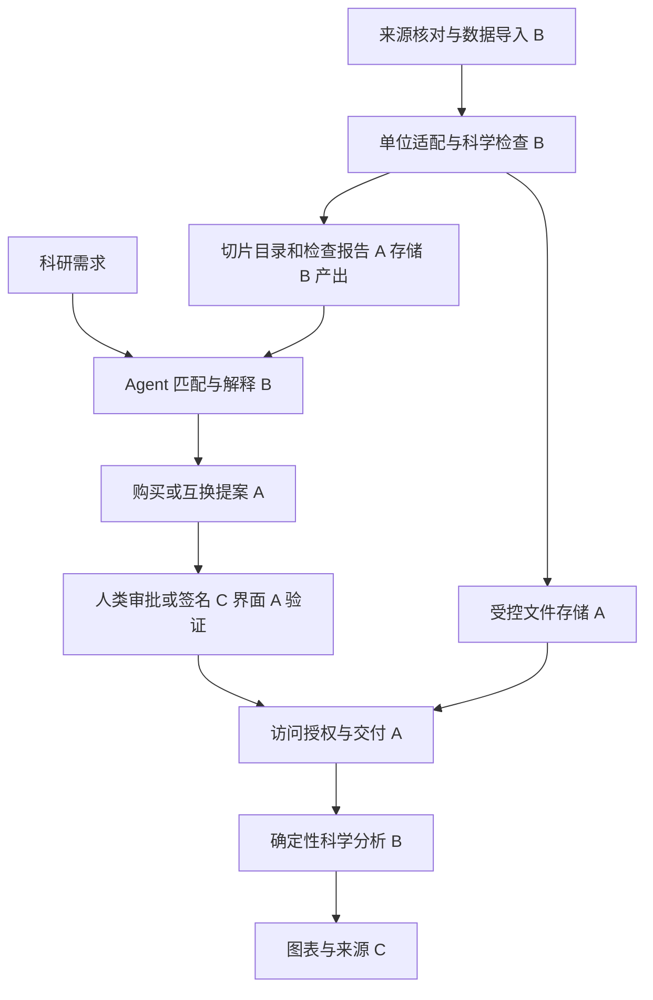

# SciExchange 候选框架与推荐组合

基于 `257c951` 的 v4 白皮书和三人分工。推荐共用一套数据目录、科学检查、授权交付和分析底座，再根据数据准备情况选择单领域或双领域演示。所有方案均为设计建议；目前主分支只包含文档。

## 三种范围

| 方案 | 能展示什么 | 实现前提 | 建议 |
|---|---|---|---|
| 单领域电池交换 | 按研究条件找切片、展示检查结果、双方确认、交付、容量衰减比较 | 两份可用电池切片及清楚的来源；两方身份可以模拟，不能改写真实数据归属 | 最小可交付版本，也作为双领域版本的数据不足回退路径 |
| 催化与电池交换 | 保留新版提案的双 Agent、PI 审批、两套领域图表 | 实验催化数据和电池循环内数据都检查通过；双方需求明确写入演示设定 | 目标版本；先各自分析，不预设跨领域因果关系 |
| 跨节点数据金库 | 多提供者托管、额度记账、支付与节点交付 | 额外的信任模型、存储和清算协议、故障恢复与测试 | 后续扩展；不作为前两种方案的必需依赖 |

用户目标仍是能运行的比赛原型。上述范围共享对象和接口，不分别搭建三个系统。付款与互换是两种取得授权的方式，可以接入同一个交付服务。

## 从候选工作中采用什么

| 来源 | 已阅读范围 | 可采用的设计 | 本次采用边界 |
|---|---|---|---|
| [SciCat backend](https://github.com/SciCatProject/backend) | README、BSD-3-Clause 许可及目录系统背景论文 | 科学元数据目录、来源与访问信息 | 借鉴字段组织，不引入整套 NestJS 与 MongoDB 部署 |
| [datalab](https://github.com/datalab-org/datalab) | README 架构说明、MIT 许可 | 样品与实验记录关联；元数据与原始文件分离 | 借鉴实验对象组织；未运行其服务 |
| [Scientific Data Skills](https://arxiv.org/html/2608.19625v2) | 预印本第 3 节表示与构建、第 4 节资源库 | 将字段语义、访问方法、使用步骤、检查与来源组织成数据说明 | 编写受控的使用说明卡；不自动执行外部说明里的脚本，也不声称复现论文效果 |
| [Battery Data Toolkit](https://rovi-org.github.io/battery-data-toolkit/user-guide/schemas/index.html) | README、来源与测量表 Schema 文档、Apache-2.0 许可 | 电池数据来源元数据和测量列定义 | 首份文件可先用显式列映射；需要多格式时再引入库 |
| [BEEP](https://github.com/TRI-AMDD/beep) | README、论文摘要、Apache-2.0 许可 | 电池测试仪数据解析与结构化 | 按实际仪器文件格式选择，不把它当交易平台 |
| [Ocean Market](https://github.com/oceanprotocol/market) | README、Apache-2.0 许可 | 发布、发现和取得数据的产品流程 | 交互参考；完整链上依赖未验证，也非科学检查来源 |

SFM 的查询、来源解析和去重代码已经实际复用在 `scripts/research/`。其余候选主要提供设计参考，不应写成“已集成的依赖”。

## 推荐数据流

B 的分析入口通过 A 的受控交付服务取得获准切片，不能按客户端传来的本地路径读取文件。Agent 只能调用受限工具；是否有权限、能否扣款、交付哪个版本，由后端检查。

## 共同数据对象建议

以下由 B 提出语义，交给 A 维护共享 Schema 与存储实现。

| 对象 | 最少需要的内容 |
|---|---|
| 数据来源与版本 | 来源 URL/DOI、原作者、数据许可、源版本、原始文件哈希、转换版本 |
| 数据切片 | 父版本、选择条件、电芯或样品 ID、字段与单位、交付文件哈希、可见范围 |
| 检查报告 | 输入哈希、规则 ID/版本、适用前提、观测值、阈值、`pass/warn/fail/not_checked`、原因 |
| 使用说明 | 测量语义、读取方式、可执行分析、必需字段、已知限制和引用方式 |
| 交易协议 | 双方身份、精确切片版本与哈希、用途、许可、有效期、报价或交换条件、双方确认记录 |
| 访问授权 | 获准主体、切片与版本、操作范围、有效期、对应协议 |
| 分析记录 | 输入哈希、方法与代码版本、参数、实际覆盖区间、输出、警告及来源 |

数据版本只新增，不在原版本上静默覆盖。哈希用于发现内容变化；来源与科学真实性需要另外的证据。首次实现可用 FastAPI、Pydantic、SQLAlchemy、SQLite 和受控文件目录；这是给 A 的建议，不是 B 另建的平台数据库。

## 双方确认与交付

协议先固定版本和内容，再由双方确认。若采用新版的 Ed25519，应验证双方对同一规范化协议内容的签名，并绑定身份、用途、有效期和防重放标识。私钥留在签名端，后端接收公钥身份与签名进行验证。Agent 签名和人类 PI 签名的角色需要在契约中分别说明。

中心化演示可以在一次数据库事务中同时创建双方授权，并支持失败后的幂等重试。这表示授权同时生效，不保证两个网络下载同时结束，也不是无可信第三方的公平交换证明。时间戳与签名证明的范围是指定内容和签署记录，不自动证明科学首创权。

[x402 的官方协议](https://github.com/x402-foundation/x402)处理 HTTP 支付验证与结算。互换审批、许可和科学数据交付仍需由 SciExchange 实现；仅返回 HTTP 402 不能作为已实现完整 x402 的证据。

## 首次联调应证明的行为

- 缺失计算所需字段时返回 `insufficient_data`，不制造拟合值或曲线。
- 未授权者不能下载或通过分析接口间接读取受限切片。
- 单方确认不交付；双方确认后获得协议中固定的版本；重复请求不重复扣款或重复执行交换。
- 文件被更改时能发现哈希不一致；正常交付能追溯来源和转换。
- 展示可比较的实验条件，也明确列出条件未知或不匹配的原因。
- 合成故障切片标记为 `synthetic_fault_injection`；不能把真实公开数据的作者重新标记成模拟实验室。
